# Minecraft Paintings

**Minecraft Paintings** is a small-scale aesthetic content mod that adds [all 30 paintings featured in Minecaft](url=https://minecraft.fandom.com/Painting), manually recreated to include less noise and tile dimensions fitting Terraria paintings. While you won't be able to hide your secret passageways with these, they are still excellent at spicing up your town and base!

Each painting can be crafted at a [i:36] Work Bench using 8 of any [i:9] Wood type and 1 of any [i:1073] Paint type.

For a visual gallery of all the paintings and how they look compared to their Minecraft counterparts, check out the mod's [GitHub repo](https://github.com/Barometz-Mod/MinecraftPaintings)!

> [!TIP]
> * Earth, Fire, Water, and Wind additionally require [Ecto Mist](https://terraria.wiki.gg/Ecto_Mist) to craft.

::: spoiler Paintings
Item | Painting | Size
-----|----------|------
Alban|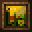| 2x2
Aztec|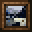| 2x2
Aztec2|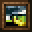| 2x2
Bomb|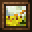| 2x2
Burning Skull|| 3x3
Bust|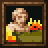| 3x3
Courbet|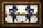| 3x2
Creebet|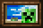| 3x2
Donkey Kong|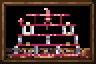| 6x4
Fighters|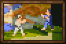| 6x4
Graham|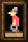| 2x3
Kebab|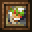| 2x2
Match|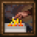| 3x3
Pigscene|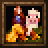| 3x3
Plant|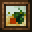| 2x2
Pointer|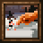| 3x3
Pool|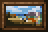| 3x2
Sea|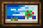| 3x2
Skeleton|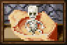| 6x4
Skull and Roses|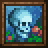| 3x3
Stage|| 3x3
Sunset|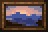| 3x2
Void|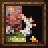| 3x3
Wanderer|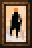| 2x3
Wasteland|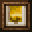| 2x2
Wither|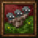| 3x3
:::

::: spoiler Graveyard
Item | Painting | Size
-----|----------|------
Earth|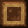| 2x2
Fire|| 2x2
Water|| 2x2
Wind|| 2x2
:::

Thanks to **dylan#3865** for the showcase images!