The **Split Mod** is a Terraria expansion that brings a fresh experience without losing the game's charm: fun weapons, bosses with bizarre personalities, new world structures and much more. This package is the **Bunny Loader port** of Split 1.0.11, with all the content **up to Paraffin**.

> [!TIP]
> Start in the Corruption or the Crimson: the **Twilight Walker** shows up there and sells the 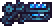 item that calls the **Spirit** at night.

## Bosses

| Boss | How to fight it |
|:---|:---|
| 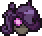 **Spirit** | At night, with the Twilight Walker's item, in the evil biome |
| 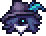 **One-Shot** | Destroy the Ice Prison on the Stranded Ship |
| 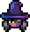 **Menace** | At night, challenge the Menacing Person or let the Menace possess the Astrologist |
| 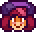 **Paraffin** | Free the creature trapped in the Underworld, or use the 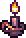 Sinister Candle |

Mini-bosses: **Colossus** (Blood Moon), **Fairyfly** (rain in the Hallow) and **Breathtaker** (throw an 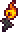 Awesome Looking Match into the lava of the Underworld Domain).

## World

- **Stranded Ship**: in the Underground Snow, with enemies, fishing, chests and 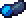 Frostbite Wood furniture.
- **Underworld Domain**: right above the Underworld, with 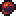 Basaltite, rooms, the Champion Chest and the Blast Forge.

## Systems

- **Photography**: bring the Shutterbug to town, take pictures of monsters and complete the album.
- **Mana Overload** 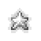: mana above the maximum becomes a reserve for mages.
- **Heavy melee**: greatswords and hammers with stances and charged swings.

## NPCs

- 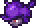 **Genoshi**, the collector, with his trades.
- 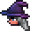 **Astrologist** and **Shutterbug**, town residents.
- **Twilight Walker**, in the evil lands, and the 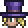 **Magician**, who visits on some hardmode nights.

## Items

Hundreds of weapons (racquets, heavy greatswords, minions, sentries, whips, yoyos), armor, accessories, potions, pets, mounts like the 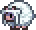 **Sheep**, furniture, paintings and music boxes.

> [!NOTE]
> What comes after Paraffin (Mirage, Insurgent, Seth and the Unchained) is still being ported. The shops are ready for it: the items show up on their own when they arrive.

## Credits

Split belongs to its original authors: **Doctor Hummer, Instrex, Cloud, Lunatix and Jackspy**. This port is a fan project for Bunny Loader, and all credit for the content goes to them. Enjoyed it? Support the original Split through the buttons at the top of the page.
