O **Split Mod** é uma expansão do Terraria que traz uma experiência nova sem perder o charme do jogo: armas divertidas, chefes com personalidades bizarras, estruturas novas no mundo e muito mais. Este pacote é o **port para o Bunny Loader** do Split 1.0.11, com todo o conteúdo **até a Paraffin**.

> [!TIP]
> Comece pela Corrupção ou pelo Carmim: o **Andarilho do Crepúsculo** aparece por lá e vende o 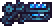 item que chama a **Spirit** à noite.

## Chefes

| Chefe | Como enfrentar |
|:---|:---|
| 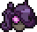 **Spirit** | À noite, com o item do Andarilho do Crepúsculo, no bioma maligno |
| 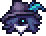 **One-Shot** | Destrua a Prisão de Gelo no Navio Encalhado |
| 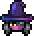 **Menace** | À noite, desafie a Pessoa Ameaçadora ou deixe a Menace possuir a Astróloga |
| 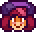 **Paraffin** | Liberte a criatura presa no Submundo, ou use a 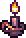 Vela Sinistra |

Mini-chefes: **Colosso** (Lua de Sangue), **Fairyfly** (chuva no Sagrado) e **Breathtaker** (jogue um 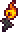 Fósforo de Aparência Incrível na lava do Domínio do Submundo).

## Mundo

- **Navio Encalhado**: na Neve Subterrânea, com inimigos, pesca, baús e a mobília de 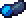 Madeira Gélida.
- **Domínio do Submundo**: logo acima do Submundo, com 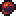 Basaltita, salas, o Baú do Campeão e a Forja Explosiva.

## Sistemas

- **Fotografia**: traga o Shutterbug para a vila, fotografe os monstros e complete o álbum.
- **Sobrecarga de Mana** 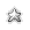: a mana que passa do máximo vira uma reserva para os magos.
- **Golpes pesados**: espadões e marretas com postura e golpes carregados.

## NPCs

- 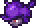 **Genoshi**, o colecionador, com as trocas.
- 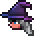 **Astróloga** e **Shutterbug**, moradores da vila.
- **Andarilho do Crepúsculo**, nas terras malignas, e 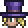 **Mágico**, visitante de algumas noites do hardmode.

## Itens

Centenas de armas (raquetes, espadões pesados, lacaios, sentinelas, chicotes, ioiôs), armaduras, acessórios, poções, pets, montarias como a 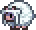 **Ovelha**, mobília, quadros e caixas de música.

> [!NOTE]
> O que vem depois da Paraffin (Mirage, Insurgent, Seth e o Unchained) ainda está sendo portado. As lojas já estão preparadas: os itens aparecem sozinhos quando chegarem.

## Créditos

O Split pertence aos seus autores originais: **Doctor Hummer, Instrex, Cloud, Lunatix e Jackspy**. Este port é um trabalho de fã para o Bunny Loader, e todo o mérito do conteúdo é deles. Gostou? Apoie o Split original pelos botões no topo da página.
